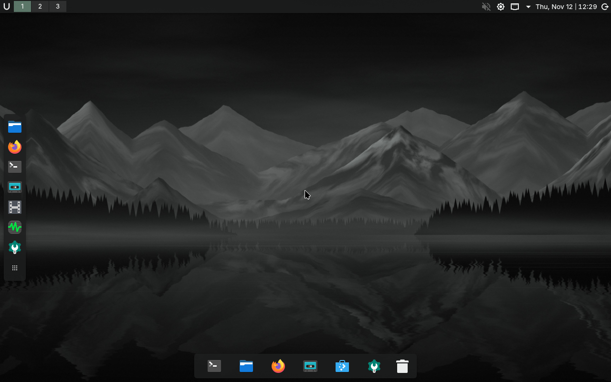
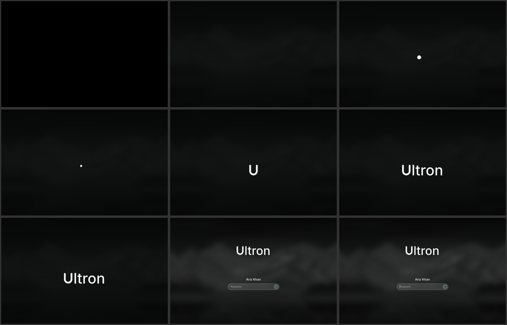
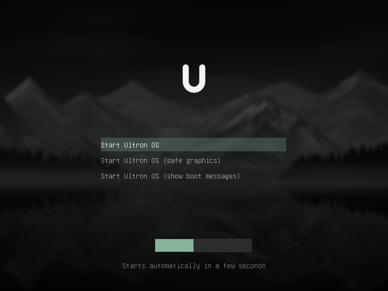
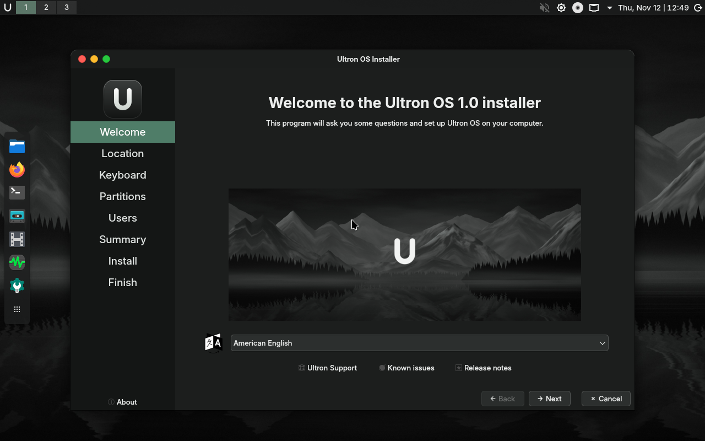
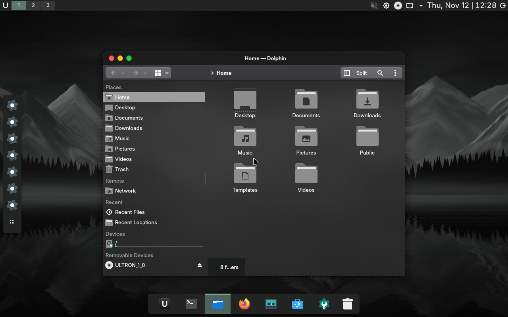
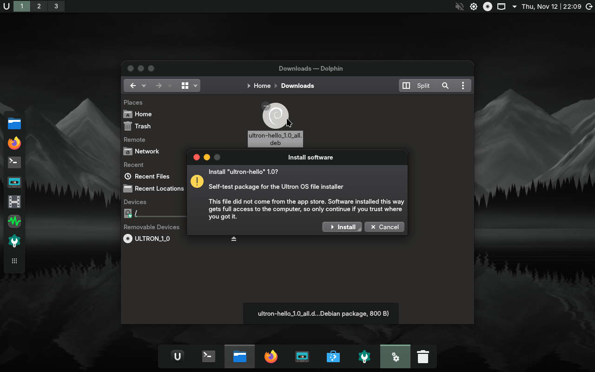

# Ultron OS

A clean, dark, glass-style Linux desktop with a one-sitting installer.



Ultron OS is a **Debian 13 remix**, not a from-scratch operating system. It takes
Debian's kernel, drivers and 60,000-package archive, and puts a carefully
configured KDE Plasma 6 desktop and a simplified installer on top. Everything
that makes it "Ultron" lives in this repository and is applied when the ISO is
built.

| | |
|---|---|
| Base | Debian 13 "trixie", Linux 6.12 LTS |
| Desktop | KDE Plasma 6.3 on Wayland |
| Look | Blur + translucency (KWin blur, Kvantum), traffic-light window buttons, top bar, floating dock |
| Start-up | A dot at boot that draws itself into the **U**, writes out "ltron", then asks for your password |
| Installer | Calamares: language, region, keyboard, disk, account, done |
| Apps | Firefox, Dolphin, Konsole, Discover (apt + Flatpak), media players, PDF/image viewers |
| Software files | Double-click a `.deb`, AppImage, Flatpak file or vendor `.run` installer: no terminal needed |
| Windows programs | `.exe` and `.msi` open on double-click through Wine 10 (64- and 32-bit) |
| Target hardware | 64-bit PC, 4 cores, 8 GB RAM (runs on less, see below) |
| ISO size | about 2.5 GB |

## From power button to desktop



1. **Boot**: a single breathing dot on black (Plymouth theme `ultron`).
2. **Sign-in**: the dot draws itself into a U, the U writes out "ltron", the
   wordmark lifts and the password field for your account fades in (SDDM theme
   `ultron`). Any key skips the animation; typing early does not lose a
   character. Set `intro=false` in
   `/usr/share/sddm/themes/ultron/theme.conf` to turn it off.
3. **Desktop**: top bar, dock, wallpaper.

The password is the one you choose in the installer. If you tick "log in
automatically" there, step 2 is skipped.

## Get the ISO

**Download a release.** Open
[Releases](https://github.com/arizkhanmagray-cyber/UltronOS/releases). The ISO
is about 2.5 GB, which is over GitHub's 2 GiB per-file limit, so it is attached
in parts. Download all parts into one folder and join them:

```
copy /b ultronos-1.0-amd64.iso.part00 + ultronos-1.0-amd64.iso.part01 ultronos-1.0-amd64.iso   (Windows)
cat ultronos-1.0-amd64.iso.part* > ultronos-1.0-amd64.iso                                         (Linux, macOS)
```

Each release page repeats the exact commands and carries a `SHA256SUMS` file
to check the result.

**Or take the latest build.** The *Build ISO* workflow runs on every push that
changes the OS definition, and on demand from the *Actions* tab. The ISO is
attached to the run as a single-file artifact (bottom of the run page; needs a
GitHub login; kept for 14 days). Pushing a tag such as `v1.1` builds and
publishes a new release.

**Build it yourself** on any Linux machine with Docker and about 20 GB free:

```sh
git clone https://github.com/arizkhanmagray-cyber/UltronOS.git
cd UltronOS
./build.sh                          # result: out/ultronos-1.0-amd64.iso
ULTRON_COMPRESSION=zstd ./build.sh  # much faster build, slightly larger ISO
```

## Install it

| Boot menu | Installer | File manager |
|---|---|---|
|  |  |  |

1. Write the ISO to a USB stick (4 GB or larger) with
   [balenaEtcher](https://etcher.balena.io/), [Rufus](https://rufus.ie/) (choose
   *DD image* mode) or `dd`.
2. Boot the computer from the stick. Both UEFI (including Secure Boot) and
   legacy BIOS are supported; see [docs/TESTING.md](docs/TESTING.md) for what
   has been verified.
3. The desktop appears and the installer opens by itself. Answer six screens:
   language, region, keyboard, **where to install**, your name and password,
   confirm.
4. Wait about ten minutes, restart, remove the stick.

On the disk screen nothing is pre-selected. *Erase disk* wipes the chosen drive;
*Install alongside* shrinks an existing Windows partition and sets up a boot
menu for both. **Back up first either way.**

You can close the installer and just try the system from the USB stick; nothing
is written to your disk until you confirm on the summary screen.

## Installing software without the terminal

The first place to look is **Discover** (the shopping-bag icon in the dock):
search, click *Install*. For files you downloaded yourself, double-click works:

| File | What a double-click does |
|---|---|
| `.deb` | Shows the package name and version, asks you to confirm and for your password, then installs it with `apt` so anything it depends on is fetched too. Tells you when it is done or, in plain words, why it failed. |
| `.flatpakref`, `.flatpak` | Opens in Discover with an *Install* button. |
| `.AppImage` | Asks once, makes the file runnable and starts it. Nothing is installed; delete the file to remove the app. |
| `.run` | Vendor self-installers: asks, then runs in a terminal window because these installers ask their questions there. |
| `.rpm` | Explains that this is the Fedora/openSUSE format and what to download instead. Converting RPMs is unreliable, so Ultron OS does not pretend to. |



Two things are deliberate. You are always asked before anything runs, and a
`.deb` always needs your password: a package file from the internet gets full
control of the computer, and an OS that installed them silently would be an
OS that installs malware silently. Plain shell scripts (`.sh`) are *not* run on
double-click for the same reason, and source archives (`.tar.gz`) have no
generic "install"; look for one of the formats above instead.

## Windows programs (.exe and .msi)

Double-click a `.exe` or `.msi` in the file manager and it opens with
[Wine](https://www.winehq.org/), which is preinstalled for both 64-bit and
32-bit programs. The first time you open a particular file you are asked to
confirm, because Wine is a compatibility layer and **not a sandbox**: a Windows
program (or Windows malware) gets the same access to your home folder as any
other app. (The file manager also asks "Execute?" first; that question is
its own, for any program file.) From a terminal the same thing is
`ultron-run-windows setup.exe`.

Be realistic about what this is. Linux does not run Windows software natively;
Wine re-implements Windows well enough for a large share of ordinary desktop
programs and installers. What generally does **not** work: games with
kernel-level anti-cheat, current Microsoft Office and Adobe Creative Cloud,
and anything that installs a hardware driver. Check
[appdb.winehq.org](https://appdb.winehq.org/) for a specific program, prefer a
native Linux version from Discover when one exists, and for stubborn programs
or games try *Bottles* or *Steam* (both in Discover).

On first use Wine may offer to download "Wine Mono" (needed for .NET
programs); accept it if you have an internet connection.

## System requirements

| | Minimum | Designed for |
|---|---|---|
| CPU | 64-bit x86, 2 cores | 4 cores |
| RAM | 4 GB | 8 GB |
| Disk | 20 GB | 64 GB SSD |
| Graphics | anything with a working Linux driver | Intel/AMD integrated or better |

What is done specifically for the 8 GB / 4-core class:

- **zram**: half of RAM (max 4 GB) as compressed swap, with kernel settings
  tuned for it, so the machine degrades gently instead of freezing when memory
  fills up.
- **systemd-oomd** kills the one runaway app instead of letting the whole
  desktop lock up.
- **No file-content indexer.** Baloo is off; searching by file name still works.
- **Lean image.** No office suite or mail client preinstalled; add what you
  need from Discover.
- **Empty session on login**, shorter animations, small journal.
- **Glass only where it is cheap.** Blur runs on the GPU. At every login
  `ultron-glass` checks for a 3D driver; without one (virtual machine without
  3D acceleration, "safe graphics" boot) it switches to solid windows so the
  CPU is not asked to do the blurring. `ultron-glass on|off|auto` overrides it.

Measured memory use is listed in [docs/TESTING.md](docs/TESTING.md).

## What is in this repository

```
build.sh                    build in a container (Docker/Podman)
scripts/build-iso.sh        the actual build, runs on Debian 13 as root
scripts/vm-test.sh          boot the ISO in QEMU for a smoke test
live-build/
  auto/config               live-build options (base, mirrors, boot, compression)
  config/package-lists/     what gets installed
  config/archives/          build-time apt pin that keeps the image lean
  config/hooks/normal/      OS identity, theme generation, services
  config/bootloaders/       boot menu of the live USB
  config/includes.chroot/   files copied into the system:
    etc/xdg/                  system-wide KDE defaults (colours, fonts, KWin, ...)
    etc/calamares/            installer flow, settings and branding
    usr/share/plasma/look-and-feel/org.ultronos.desktop/
                              the global theme: panel layout, splash
    usr/share/aurorae/themes/          window frame + traffic lights (glass and solid)
    usr/share/sddm/themes/ultron/      animated sign-in screen
    usr/bin/ultron-glass               glass on/off/auto
    usr/bin/ultron-run-windows         opens .exe / .msi with Wine
    usr/bin/ultron-install-file        installs .deb, opens AppImage / .run
    usr/share/color-schemes/           "Ultron Dark"
    usr/share/wallpapers/Ultron/       default wallpaper
    usr/share/plymouth/, usr/share/grub/   boot splash (the dot) and boot menu
assets/                     sources for the artwork (logo SVGs, generators)
docs/                       design notes and test log
```

## Change things

- **Default apps**: edit `live-build/config/package-lists/*.list.chroot`.
- **Panel/dock layout**: `…/look-and-feel/org.ultronos.desktop/contents/layouts/org.kde.plasma.desktop-layout.js`.
- **Colours**: `…/usr/share/color-schemes/UltronDark.colors`, then mirror the
  colour groups into `etc/xdg/kdeglobals`.
- **Logo, wallpaper, window frame**: edit the sources in `assets/`, run
  `assets/build-assets.sh`, commit the regenerated files.
- **Installer screens**: `…/etc/calamares/settings.conf` and `modules/*.conf`.

Then rebuild the ISO.

## Known limitations of 1.0

- Tested in QEMU only (BIOS, and UEFI with Secure Boot; software rendering).
  **Not yet tested on physical hardware**; treat it as a beta until it has
  been.
- Full-disk encryption is disabled in the installer.
- The quick-settings popup is Plasma's standard system tray, not a custom
  control-centre panel.
- Qt apps (file manager, settings, terminal) are translucent; GTK apps such as
  Firefox are dark but opaque.
- There is no Ultron package repository: system updates come straight from
  Debian, and theme updates require a new ISO or copying the files by hand.
- The EFI boot entry is named `debian`. That is deliberate; see
  [docs/DESIGN.md](docs/DESIGN.md).

## Credits and licences

Build scripts, configuration and artwork in this repository: MIT (see
[LICENSE](LICENSE)). The wallpaper and logo are original and generated by the
scripts in `assets/`.

Built on the work of [Debian](https://www.debian.org/),
[KDE](https://kde.org/), [Calamares](https://calamares.io/),
[Kvantum](https://github.com/tsujan/Kvantum) (the widget theme is derived at
build time from *KvMojave* by Tsu Jan, GPL-3.0) and the
[Papirus](https://github.com/PapirusDevelopmentTeam/papirus-icon-theme) icon
theme. Ultron OS is not affiliated with or endorsed by Debian, KDE, Apple or
Marvel.
